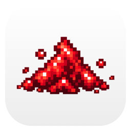
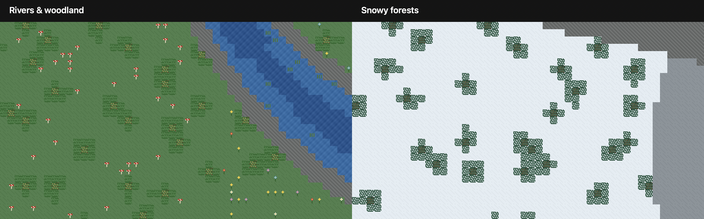
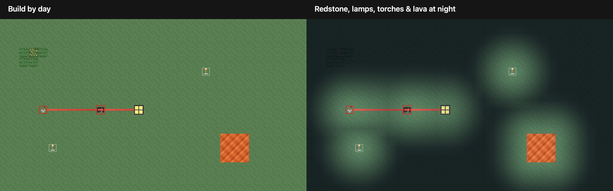

<picture>
  <source media="(prefers-color-scheme: dark)" srcset="docs/media/icon-dark.png">
  
</picture>

# Redstone Desktop

Turn your Mac desktop into a little redstone world. Build a circuit beneath your files, press a button, and open a folder — or make lights, clocks and useful desktop automations.

Your files stay in Finder, right where you left them. Everything runs locally. No account or Minecraft installation is required.

## Download

A **DMG download is coming**. There isn’t a public installer yet; the app is currently in development. It requires **macOS 14 or newer**.

Already have a build? Move **RedstoneDesktop.app** to Applications and open it normally. You don’t need Xcode to use the app. If you’re building from source, see the [development and release guide](docs/RELEASE.md).

## Your first circuit

1. Follow setup to connect to Finder. You can also import textures and sounds from your installed **Minecraft Java Edition**, or keep the original look.
2. Place a **Button**, some **Dust**, and an **Output**. Connect them into a path. Or pick a ready-made circuit from **Blueprints**.
3. Choose **Activate on Desktop**, then **Start Desktop**. Place a file or folder on the Output and press your circuit’s button.
4. Use the logo in the menu bar to stop, switch areas or return to the editor.

Want to experiment first? **Test Circuit** lets you try your build in the editor without opening files or running scripts.

## A world of your own

Explore winding rivers, forests, deserts and snowy hills. Paint the terrain, clear a spot for a build, and keep different projects in separate worlds. Save favorite places as **Areas** so you can jump back to them and choose one for your desktop.

Set each world to a day/night cycle, follow your Mac’s local time, or hold it at your favorite time of day. A custom day can last anywhere from 2 minutes to 24 hours. Torches, lava, powered dust and lamps bring it to life after dark.

These examples use the app’s original artwork, rendered with the same engine as the editor and desktop. Minecraft textures are an optional import from your own game or texture pack; they aren’t included in the download.

## More things to try

- **Reusable blueprints:** start with a switch-controlled clock or save a circuit you’ve built.
- **Desktop sensors:** detect a file on a pressure plate, or look for a particular name or extension.
- **Build on Desktop:** edit directly beneath your files, then return to normal desktop use.
- **Make it yours:** adjust textures, sounds, animations and particles in Settings. The `?` buttons explain the options.

Outputs open files by default. Running scripts is optional and asks for your approval. You can export and import your worlds in **Settings → Data**; see [backups and recovery](docs/RECOVERY.md) for restoring or starting over.

For a closer look, read the [editor guide](docs/EDITOR_TOOLS.md), [circuit guide](docs/REDSTONE_RULES.md), or [Minecraft import guide](docs/JAVA_TEXTURE_IMPORT.md).

---

Redstone Desktop is an independent project, not affiliated with Mojang or Microsoft. The code and original artwork are [MIT licensed](LICENSE). No Minecraft artwork, audio or game code is bundled. [Artwork notices](THIRD_PARTY_NOTICES.md).
