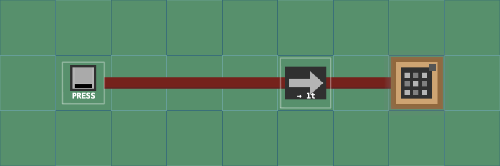

# Redstone Desktop

Build little redstone circuits underneath your real Mac desktop files. A button can open a folder, launch a file, or run a script you approve. Finder continues to manage your files normally.



## Using the app

- **Worlds** are separate maps with their own landscapes and builds. **Areas** are saved views within a world.
- Build in the editor, save or update an area, and choose **Activate on Desktop**. **Start Desktop** runs that area. Browsing another world doesn’t change the desktop assignment.
- **Test Circuit** runs a safe editor copy with Pause, Step and Reset. Outputs flash without opening files. Select groups to copy, move, rotate, undo or save reusable blueprints; [the editor guide](docs/EDITOR_TOOLS.md) walks through these tools.
- **Build on Desktop** temporarily stops the circuit and lets you place components on the desktop. Exit to use your files normally again. R rotates the hovered repeater/torch; T changes a repeater’s delay.
- **Settings → Appearance** can use textures from your installed Minecraft Java Edition. Original artwork is available without a game installation. Help buttons explain optional settings.
- **Settings → Data** exports every world, area and circuit. **Import Library** adds independent copies, preserving your existing builds and desktop assignment. The separate blueprint shelf, texture packs, desktop files and script approvals are excluded.
- **Start Over** creates a recovery backup before resetting app data. Read [the recovery guide](docs/RECOVERY.md) first. Backup/reset acceptance is still awaiting the owner’s manual testing.

The dust menu in the macOS menu bar provides Start/Stop, area selection, editor, build mode, Settings and sound controls. Choosing an area automatically resumes Desktop when it was running; a stopped desktop stays stopped. Setup can be reopened from Settings → General. Connect to Finder when asked; script access is a separate optional permission.

## Launching without Xcode

Xcode builds source code into an ordinary `.app` and provides a debugger and logs. We used it during development so each change could be rebuilt and errors could be inspected. You do **not** need Xcode running to use Redstone Desktop.

After building, quit the previous app copy and open:

```sh
open build/Build/Products/Debug/RedstoneDesktop.app
```

Or open that `.app` in Finder. For regular use, extract the release ZIP in `build/releases`, move `RedstoneDesktop.app` to Applications and double-click it. Quit the app before replacing it with a newer build. Run only one copy at a time: development and release copies use the same saved library. Editing Swift files does not update an already built app; rebuild with Xcode **⌘R** or the commands below when code changes.

Current local release builds are unsigned and not notarized. macOS may require you to approve opening them. Signing/distribution instructions are in [RELEASE.md](docs/RELEASE.md).

## Building and testing

Requirements: full Xcode with Swift 6 support, XcodeGen 2.44+ and Python 3 for release verification. Verified development toolchain: Xcode 27.0, Swift 6.4, XcodeGen 2.46.0. The application targets macOS 14+. Older macOS and Intel execution require manual validation.

```sh
xcodegen generate
open RedstoneDesktop.xcodeproj
```

In Xcode, choose **RedstoneDesktop → My Mac** and press **⌘R**. **⌘U** runs the automated tests. Alternatively:

```sh
xcodebuild -project RedstoneDesktop.xcodeproj -scheme RedstoneDesktop -configuration Debug -destination 'platform=macOS' -derivedDataPath build CODE_SIGNING_ALLOWED=NO build
xcodebuild -project RedstoneDesktop.xcodeproj -scheme RedstoneDesktop -configuration Debug -destination 'platform=macOS' -derivedDataPath build CODE_SIGNING_ALLOWED=NO test
```

Create a universal local release with `scripts/release.sh`. The Xcode project and build products are generated and ignored by Git. Test hosts and profiling fixtures isolate app data from the owner’s real saves.

## Contributor guides

- [Architecture](docs/ARCHITECTURE.md): SwiftUI/AppKit/SpriteKit boundaries, coordinates, Finder and action contracts.
- [Circuit rules](docs/REDSTONE_RULES.md) and [script Outputs](docs/SCRIPT_OUTPUTS.md).
- [Resource-pack format](docs/RESOURCE_PACKS.md) and [Minecraft Java import](docs/JAVA_TEXTURE_IMPORT.md).
- [Mac testing checklist](docs/TESTING.md), [known limitations](docs/KNOWN_LIMITATIONS.md), [diagnostics](docs/DIAGNOSTICS.md) and [profiling](docs/PROFILING.md).
- [Recovery](docs/RECOVERY.md) and [release engineering](docs/RELEASE.md).

The implementation roadmap in `SPEC.md` was retired at the owner’s request once development moved into ongoing polish. Its history remains in Git. Current contracts and outstanding manual checks live in the guides above; automated results do not substitute for physical Mac acceptance.

## Artwork and license

Project code and original art use [MIT](LICENSE). The owner explicitly requested the shipped Minecraft dust graphic and derived monochrome tool icons; those assets are excluded from MIT and identified in [THIRD_PARTY_NOTICES.md](THIRD_PARTY_NOTICES.md). Optional imported world textures remain local, outside Git and release bundles. No JAR, game code or resource-pack code is bundled or executed.

Regenerate app/menu dust icons by compiling `scripts/GenerateAppIcons.swift` alongside `RedstoneDesktop/App/AppIdentityArtwork.swift` with `swiftc -swift-version 6 -parse-as-library`, then running the resulting executable with the repository root as its argument. Tool icons are generated with `swift scripts/generate-tool-icons.swift SOURCE_DIRECTORY RedstoneDesktop/Resources/Assets.xcassets`; extract only the sources listed in `scripts/tool-icon-sources.json` from your local Java 1.21.11 JAR into files named Dust.png, Button.png, Lever.png, Repeater.png, Output.png and Torch.png. Do not commit the JAR or unrelated game assets.
